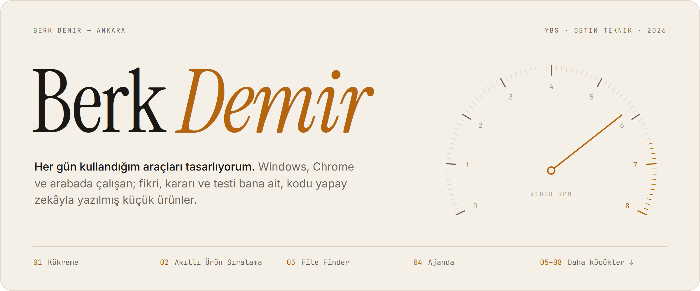
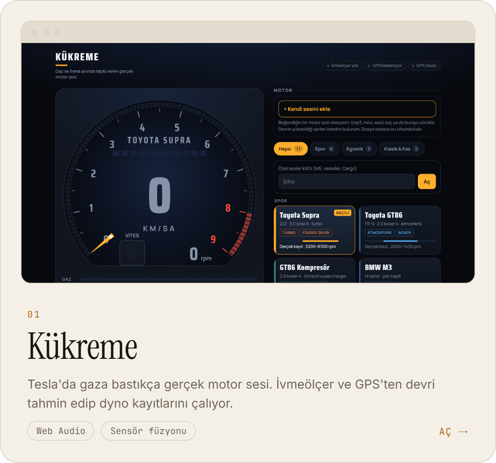
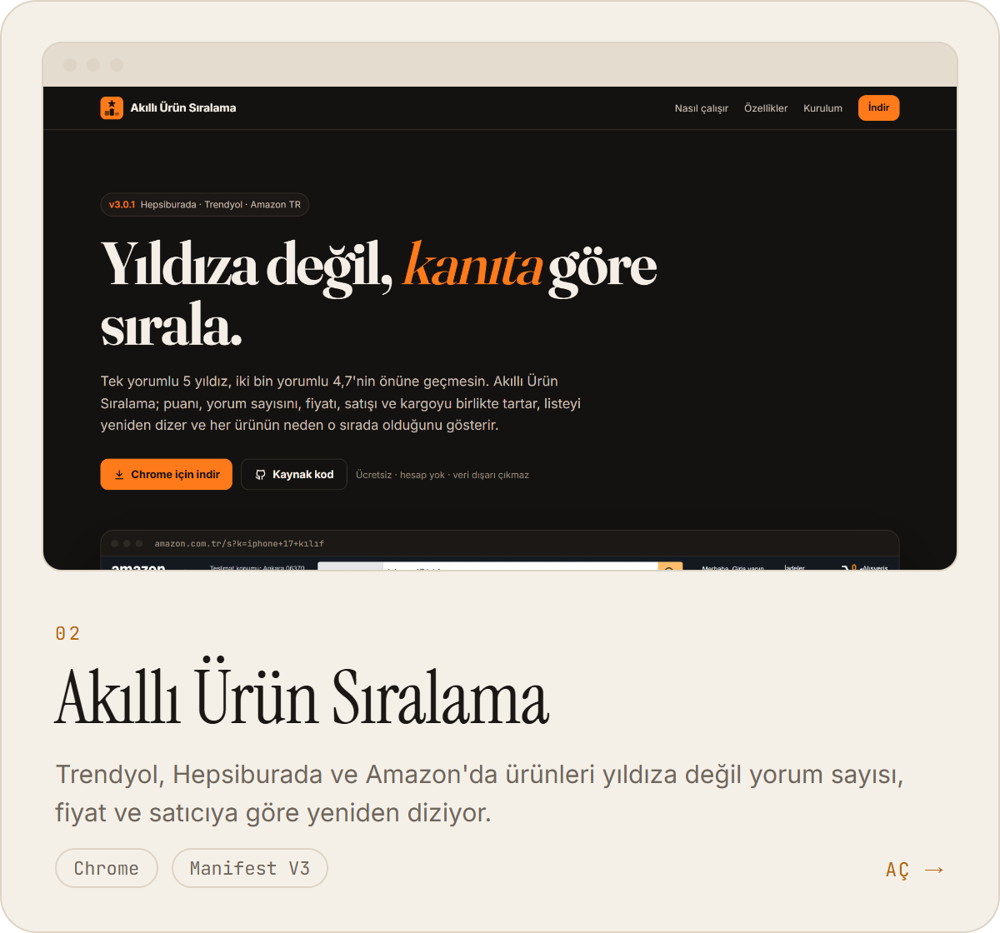
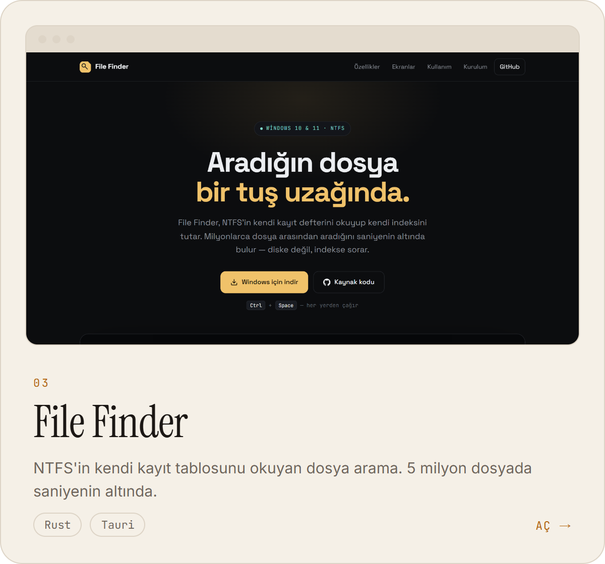
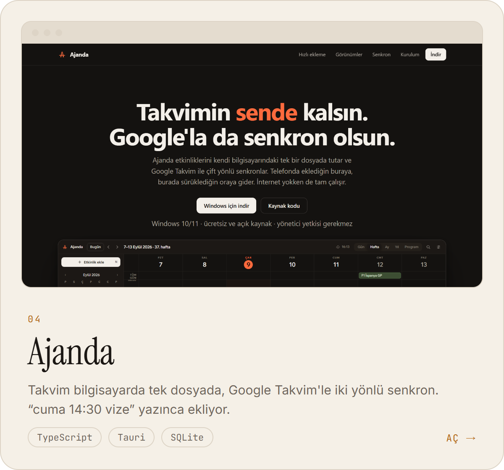
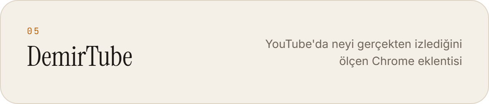
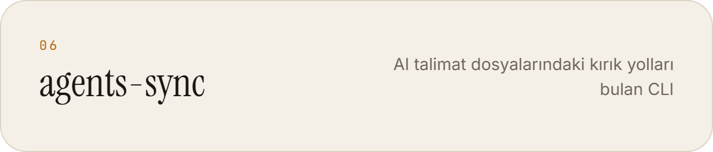
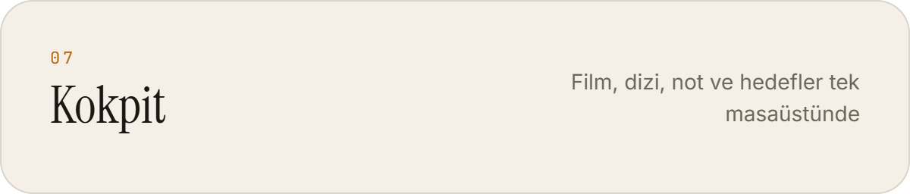
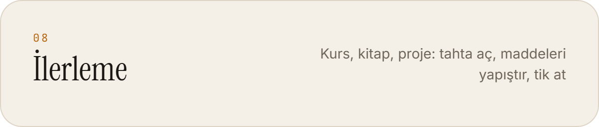
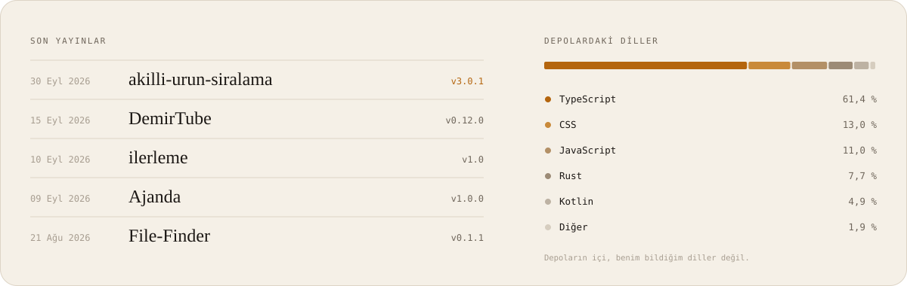

<a href="https://github.com/berkdemir18/berkdemir18"><picture><source media="(prefers-color-scheme: dark)" srcset="assets/hero-dark.png"></picture></a>

<a href="https://berkdemir18.github.io/kukreme/"><picture><source media="(prefers-color-scheme: dark)" srcset="assets/p01-dark.png"></picture></a>
<a href="https://berkdemir18.github.io/akilli-urun-siralama/"><picture><source media="(prefers-color-scheme: dark)" srcset="assets/p02-dark.png"></picture></a>

<a href="https://berkdemir18.github.io/File-Finder/"><picture><source media="(prefers-color-scheme: dark)" srcset="assets/p03-dark.png"></picture></a>
<a href="https://berkdemir18.github.io/Ajanda/"><picture><source media="(prefers-color-scheme: dark)" srcset="assets/p04-dark.png"></picture></a>

<a href="https://github.com/berkdemir18/DemirTube"><picture><source media="(prefers-color-scheme: dark)" srcset="assets/s05-dark.png"></picture></a>
<a href="https://berkdemir18.github.io/agents-sync/"><picture><source media="(prefers-color-scheme: dark)" srcset="assets/s06-dark.png"></picture></a>

<a href="https://github.com/berkdemir18/Kokpit"><picture><source media="(prefers-color-scheme: dark)" srcset="assets/s07-dark.png"></picture></a>
<a href="https://github.com/berkdemir18/ilerleme"><picture><source media="(prefers-color-scheme: dark)" srcset="assets/s08-dark.png"></picture></a>

<picture><source media="(prefers-color-scheme: dark)" srcset="assets/yayinlar-dark.svg"></picture>

<picture><source media="(prefers-color-scheme: dark)" srcset="assets/foot-dark.png"></picture>

