

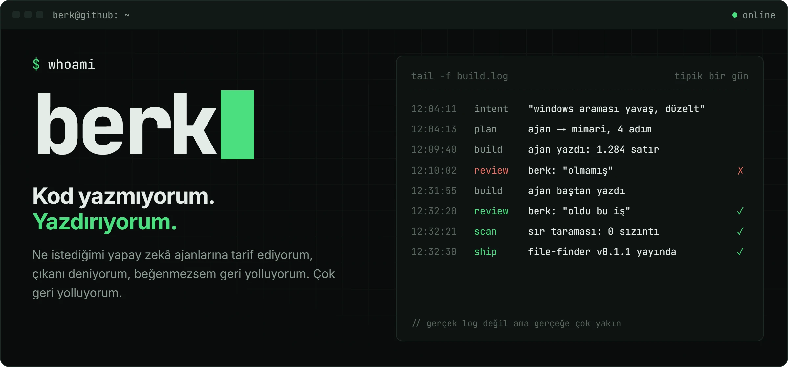

<a href="https://github.com/berkdemir18/DemirTube">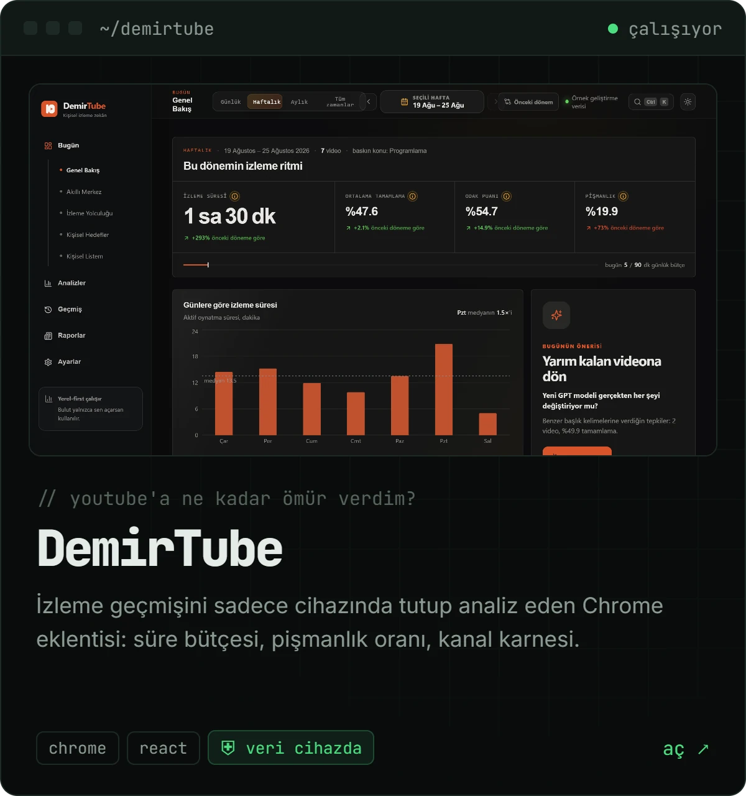</a>
<a href="https://berkdemir18.github.io/agents-sync/">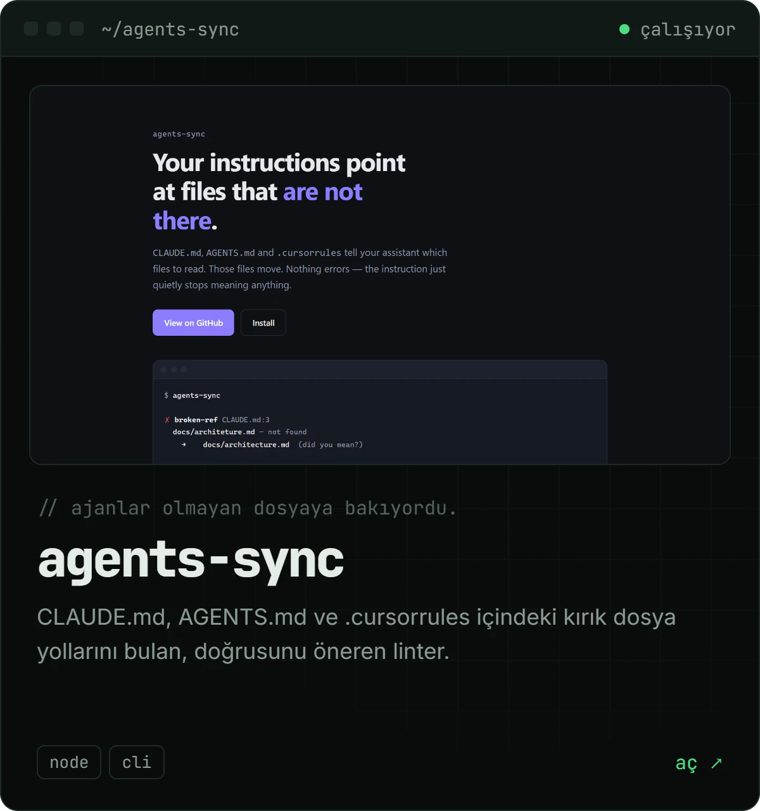</a>

<a href="https://berkdemir18.github.io/File-Finder/">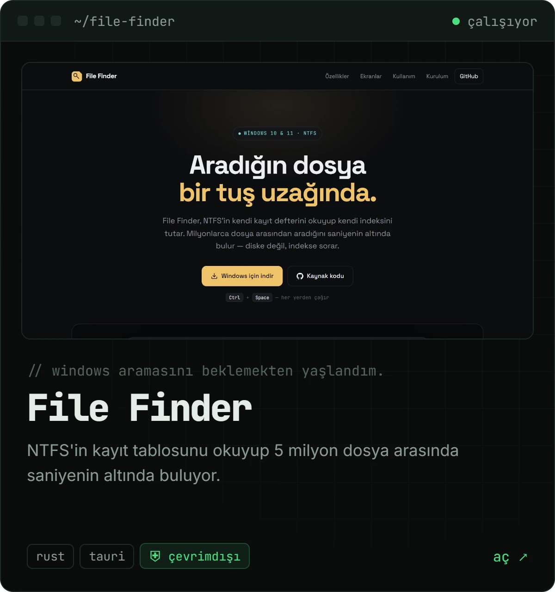</a>
<a href="https://berkdemir18.github.io/Ajanda/">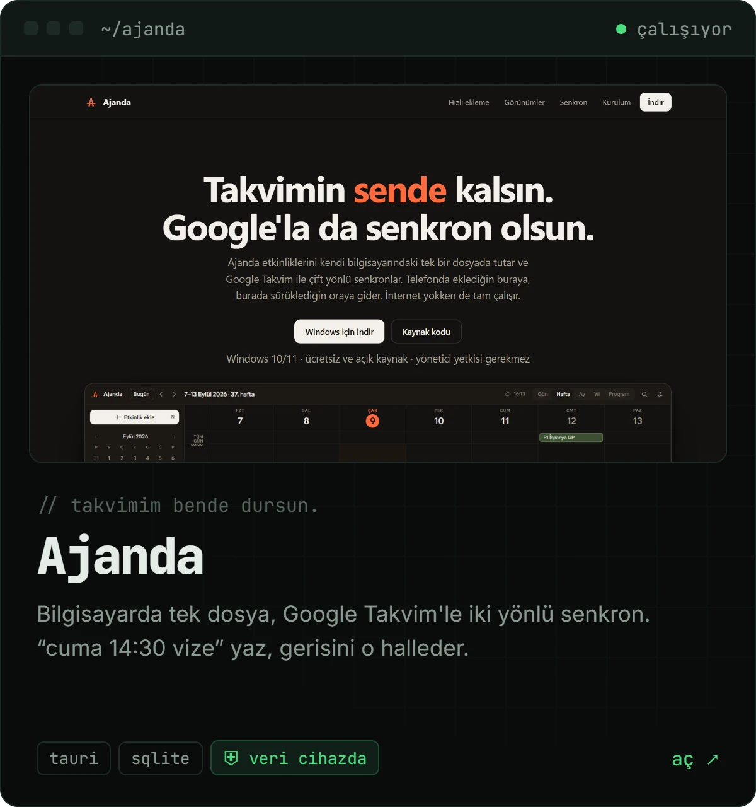</a>

<a href="https://berkdemir18.github.io/kukreme/">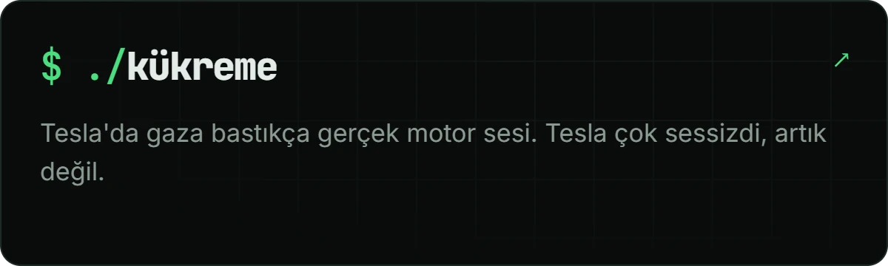</a>
<a href="https://berkdemir18.github.io/akilli-urun-siralama/">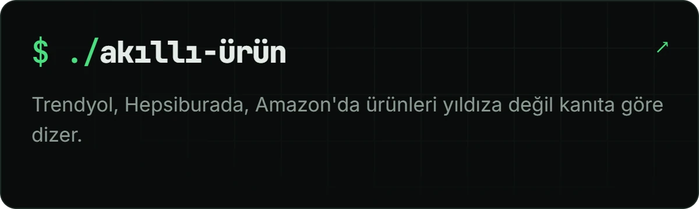</a>

<a href="https://github.com/berkdemir18/Kokpit">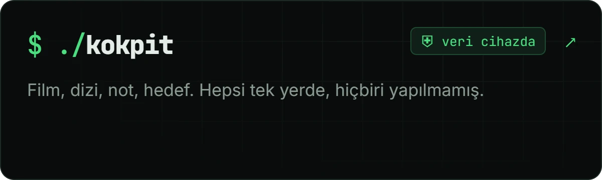</a>
<a href="https://github.com/berkdemir18/ilerleme">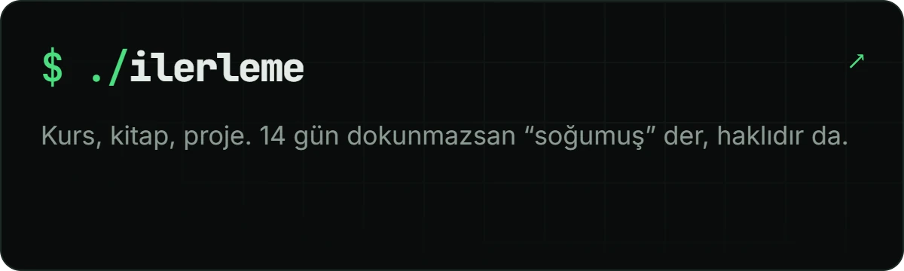</a>

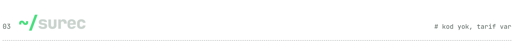

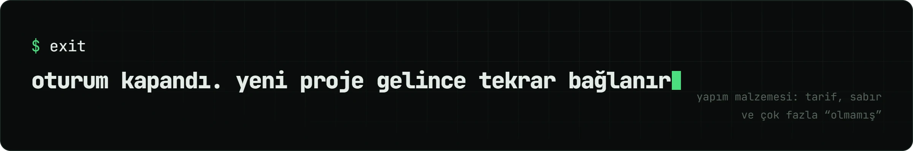

