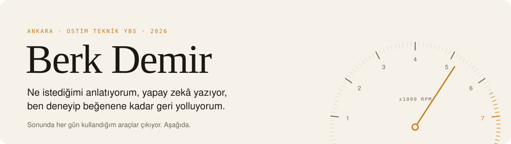
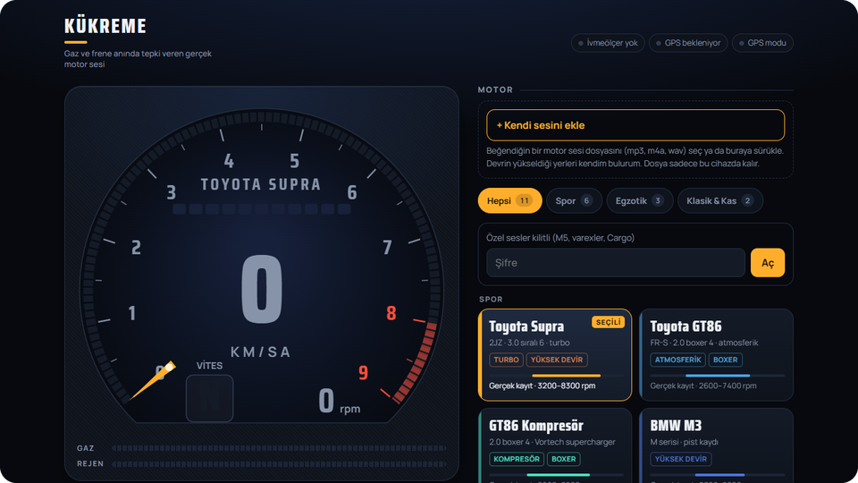
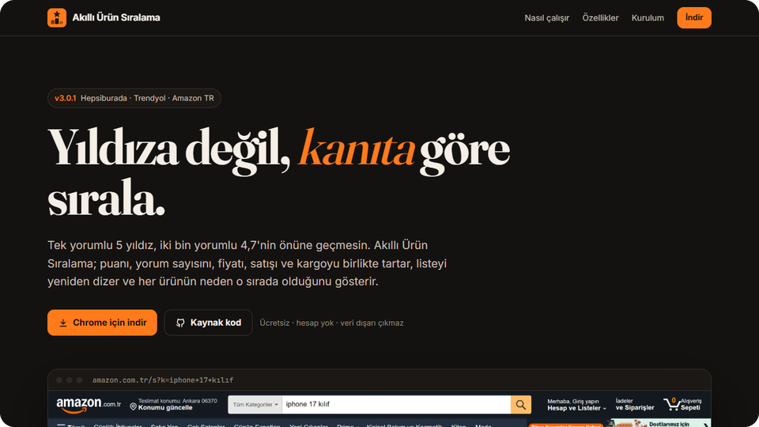
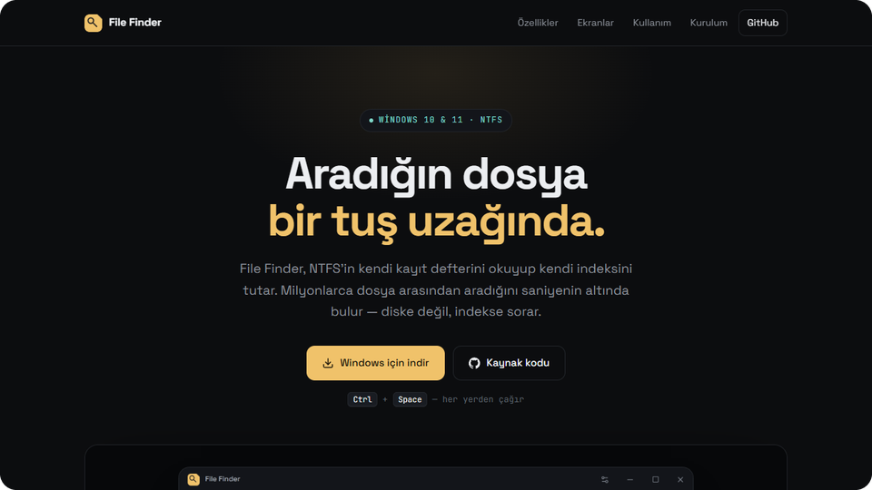
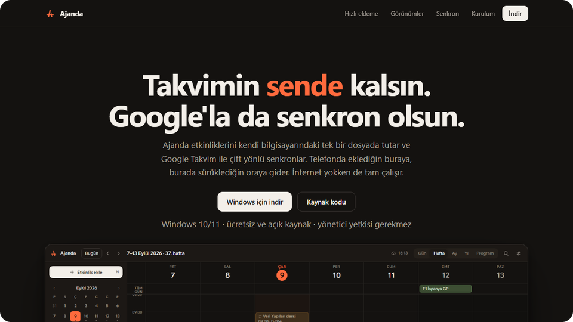
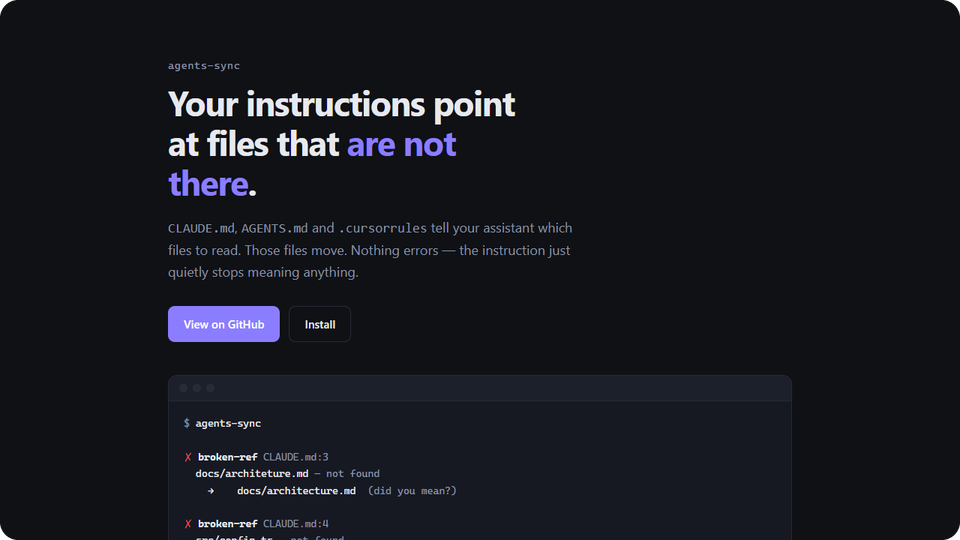

<picture>
  <source media="(prefers-color-scheme: dark)" srcset="assets/banner-dark.svg">
  
</picture>

<br/>

Selam, ben Berk. Ankara'dayım, Ostim Teknik'te Yönetim Bilişim Sistemleri okuyorum.

Elle kod yazmıyorum. Bir şey canımı sıkınca ne istediğimi yapay zekâya anlatıyorum, çıkanı kullanıyorum, olmamışsa neden olmadığını söyleyip tekrar yaptırıyorum. Aşağıdakiler böyle çıktı ve hepsini gerçekten kullanıyorum.

<br/>

## Öne çıkanlar

<table>
<tr>
<td width="50%" valign="top">
<a href="https://berkdemir18.github.io/kukreme/"></a>

**[Kükreme](https://github.com/berkdemir18/kukreme)**<br/>
Tesla'da gaza bastıkça gerçek motor sesi. Telefonun ivmeölçeri ve GPS'iyle devri tahmin ediyor, dyno kayıtlarını ona göre çalıyor.

<sub>[aç ↗](https://berkdemir18.github.io/kukreme/) · JavaScript · Web Audio</sub>
</td>
<td width="50%" valign="top">
<a href="https://berkdemir18.github.io/akilli-urun-siralama/"></a>

**[Akıllı Ürün Sıralama](https://github.com/berkdemir18/akilli-urun-siralama)**<br/>
Hepsiburada, Trendyol ve Amazon'da tek yorumlu 5 yıldızı, iki bin yorumlu 4,7'nin önüne geçirmeyen Chrome eklentisi.

<sub>[tanıtım ↗](https://berkdemir18.github.io/akilli-urun-siralama/) · [indir](https://github.com/berkdemir18/akilli-urun-siralama/releases/latest) · Manifest V3</sub>
</td>
</tr>
<tr>
<td width="50%" valign="top">
<a href="https://berkdemir18.github.io/File-Finder/"></a>

**[File Finder](https://github.com/berkdemir18/File-Finder)**<br/>
Windows'ta dosya arama. NTFS'in kendi kayıt tablosunu okuyor; 5 milyon dosya arasında saniyenin altında buluyor.

<sub>[tanıtım ↗](https://berkdemir18.github.io/File-Finder/) · [indir](https://github.com/berkdemir18/File-Finder/releases/latest) · Rust · Tauri</sub>
</td>
<td width="50%" valign="top">
<a href="https://berkdemir18.github.io/Ajanda/"></a>

**[Ajanda](https://github.com/berkdemir18/Ajanda)**<br/>
Takvim bilgisayarda bir dosyada duruyor, Google Takvim'le iki yönlü senkron. `cuma 14:30 vize 2 saat` yazınca ekliyor.

<sub>[tanıtım ↗](https://berkdemir18.github.io/Ajanda/) · [indir](https://github.com/berkdemir18/Ajanda/releases/latest) · TypeScript · Tauri</sub>
</td>
</tr>
<tr>
<td width="50%" valign="top">
<a href="https://berkdemir18.github.io/agents-sync/"></a>

**[agents-sync](https://github.com/berkdemir18/agents-sync)**<br/>
`CLAUDE.md`, `AGENTS.md` gibi dosyalarda artık var olmayan yolları bulan komut satırı aracı. Kendi derdimden çıktı.

<sub>[tanıtım ↗](https://berkdemir18.github.io/agents-sync/) · Node.js · sıfır bağımlılık</sub>
</td>
<td width="50%" valign="top">

**Daha küçükler**

**[DemirTube](https://github.com/berkdemir18/DemirTube)** <br/><sub>YouTube'da ne kadarını gerçekten izlediğimi ve neye pişman olduğumu ölçen eklenti. Veri cihazdan çıkmıyor.</sub>

**[İlerleme](https://github.com/berkdemir18/ilerleme)** <br/><sub>Kurs, kitap, proje. Tahta aç, maddeleri yapıştır, tik at. 14 gün dokunmazsan "soğumuş" diyor.</sub>

**[Kokpit](https://github.com/berkdemir18/Kokpit)** <br/><sub>Film/dizi, notlar, hedefler tek uygulamada. Asistanım veriyi MCP üzerinden okuyabiliyor.</sub>

**[BerkStream-Hub](https://github.com/berkdemir18/BerkStream-Hub)** <br/><sub>Kendi kullandığım eklentilerin derlemesi.</sub>

</td>
</tr>
</table>

<br/>

## Son yayınlar

<!-- YAYINLAR:BASLA -->
| | proje | sürüm |
|---|---|---|
| <sub>30 Eyl 2026</sub> | [akilli-urun-siralama](https://github.com/berkdemir18/akilli-urun-siralama) | [`v3.0.1`](https://github.com/berkdemir18/akilli-urun-siralama/releases/tag/v3.0.1) |
| <sub>30 Eyl 2026</sub> | [akilli-urun-siralama](https://github.com/berkdemir18/akilli-urun-siralama) | [`v3.0.0`](https://github.com/berkdemir18/akilli-urun-siralama/releases/tag/v3.0.0) |
| <sub>15 Eyl 2026</sub> | [DemirTube](https://github.com/berkdemir18/DemirTube) | [`v0.12.0`](https://github.com/berkdemir18/DemirTube/releases/tag/v0.12.0) |
| <sub>13 Eyl 2026</sub> | [DemirTube](https://github.com/berkdemir18/DemirTube) | [`v0.11.3`](https://github.com/berkdemir18/DemirTube/releases/tag/v0.11.3) |
| <sub>13 Eyl 2026</sub> | [DemirTube](https://github.com/berkdemir18/DemirTube) | [`v0.11.2`](https://github.com/berkdemir18/DemirTube/releases/tag/v0.11.2) |
<!-- YAYINLAR:BITIR -->

<details>
<summary><b>Depolarda hangi diller var</b></summary>
<br/>

Bu tablo depoların içini gösteriyor, benim bildiğim dilleri değil.

<!-- DILLER:BASLA -->
```text
┌─ depolardaki dil dağılımı ─────────────────────────────────┐
│                                                            │
│  TypeScript  ██████████████████████░░░░░░░░░░░░░░   61,4 % │
│  CSS         █████░░░░░░░░░░░░░░░░░░░░░░░░░░░░░░░   13,0 % │
│  JavaScript  ████░░░░░░░░░░░░░░░░░░░░░░░░░░░░░░░░   11,0 % │
│  Rust        ███░░░░░░░░░░░░░░░░░░░░░░░░░░░░░░░░░    7,7 % │
│  Kotlin      ██░░░░░░░░░░░░░░░░░░░░░░░░░░░░░░░░░░    4,9 % │
│  Diğer       █░░░░░░░░░░░░░░░░░░░░░░░░░░░░░░░░░░░    1,9 % │
│                                                            │
└─ toplam ~3,1 MB · 9 depo ──────────────────────────────────┘
```
<!-- DILLER:BITIR -->

</details>

<br/>

<p align="center"><sub>Beşiktaş · Ferrari · bir de arabada Kükreme açık. Son iki bölüm her gün kendiliğinden güncelleniyor.</sub></p>
